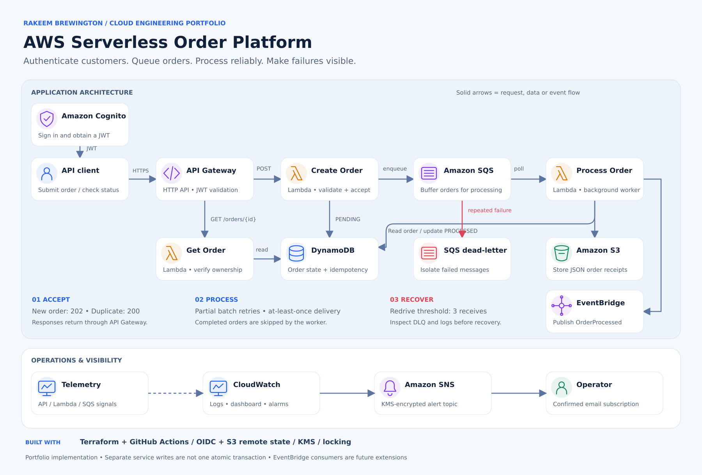
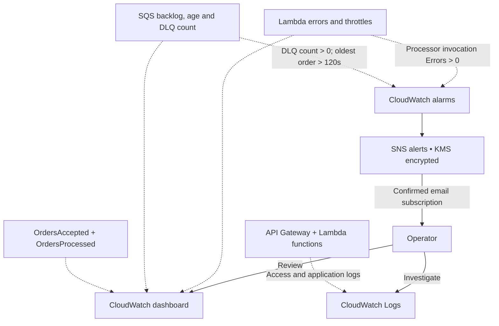

# Serverless Order Processing Platform on AWS

A production-style portfolio project that accepts authenticated orders, processes them asynchronously, survives duplicate requests and worker failures, and alerts an operator when the system is unhealthy.

## Business problem

An online retailer was losing orders during traffic spikes and occasionally fulfilling duplicate orders after clients retried timed-out requests. The company needed fast API responses, reliable background processing, clear order status, and operational alarms without maintaining servers.

## Solution

- Amazon Cognito authenticates callers.
- API Gateway exposes POST /orders and GET /orders/{order_id}.
- A Python Lambda validates orders and returns HTTP 202 Accepted.
- DynamoDB stores order state and supports deterministic idempotency.
- SQS buffers traffic and retries temporary processing failures.
- A dead-letter queue isolates messages that repeatedly fail.
- A worker Lambda creates a receipt in S3 and emits an EventBridge event.
- CloudWatch dashboards, logs, metrics, and alarms expose failures and queue delay.
- SNS sends operational notifications.
- Terraform provisions the complete platform.

## Architecture

This portfolio models an authenticated order API with asynchronous processing. The diagrams below reflect the Terraform and Python implementation in this repository.

### Order submission and status lookup

[Open the full-size architecture graphic](docs/images/serverless-order-platform.svg)

1. **Authenticate:** the client obtains a Cognito token. API Gateway validates the JWT before invoking either API Lambda.
2. **Accept:** Create Order validates the payload and derives an order ID from the customer identity and idempotency key. A new record returns **202**; an existing record returns **200**. Both paths enqueue the order ID.
3. **Process:** Lambda polls SQS, writes the receipt, conditionally updates the order to `PROCESSED`, and attempts to publish an `OrderProcessed` event.
4. **Check status:** Get Order reads DynamoDB and checks that the authenticated customer owns the order. Responses return through API Gateway; response arrows are omitted for clarity.
5. **Recover:** failed records are returned as partial batch failures and retried. Repeatedly failing messages move to the DLQ.

### Monitoring and failure alerts

Dotted arrows represent telemetry; solid arrows represent notifications or operator actions. The queue-age alarm requires two consecutive 60-second evaluation periods. Record-level failures returned in a successful partial-batch response do **not** necessarily increment the Lambda `Errors` metric; logs, queue age, and the DLQ provide additional evidence.

### Design decisions and operating boundaries

| Decision | Purpose | Current implementation |
| --- | --- | --- |
| Separate create and get functions | Keep writes and status reads distinct | Separate IAM roles; Get Order has DynamoDB read access |
| Queue between API and worker | Let API acceptance finish before processing | 90-second visibility timeout; 30-second worker timeout |
| Bounded processing | Limit downstream pressure | Batch size 10; batching window 5 seconds; maximum consumer concurrency 5 |
| Duplicate handling | Reuse the order identity across retries | Conditional DynamoDB writes and a deterministic S3 receipt key |
| Failure isolation | Preserve problematic messages for investigation | Order retention 4 days; DLQ retention 14 days |
| Infrastructure as code | Make the environment reproducible | Terraform; manual GitHub Actions deployment using OIDC; KMS-encrypted S3 state with locking |

**Scope and limits:** this is an at-least-once processing design, not an exactly-once transaction across DynamoDB, SQS, S3, and EventBridge. The DynamoDB write and SQS send are separate operations; a send failure can leave an order pending until a client retry or reconciliation. Event publication happens after the status update, so a failure can leave a processed order without its event. A transactional outbox and reconciliation would be useful production improvements. The event bus is an extension point; no downstream consumer is shown here.

Implementation references: [API routes](infra/platform/api.tf), [Lambda permissions and polling](infra/platform/lambdas.tf), [queues and alerts](infra/platform/messaging.tf), [monitoring](infra/platform/monitoring.tf), and [application code](src/).

## Real-world failures this project handles

| Failure | Design response |
| --- | --- |
| Customer submits the same order twice | The Idempotency-Key creates the same order ID and the worker safely ignores completed orders. |
| Sudden order spike | SQS absorbs the burst while Lambda scales consumers. |
| One message in a batch fails | Partial batch responses retry only the failed SQS record. |
| Repeated processing failure | SQS moves the message to a dead-letter queue and CloudWatch alarms. |
| Worker writes a receipt twice | The deterministic S3 object key makes the write repeatable. |
| Unauthorized caller | API Gateway verifies a Cognito JWT before invoking Lambda. |
| Operator cannot see the problem | Logs, custom metrics, a dashboard, alarms, and SNS expose the condition. |

## Repository layout

~~~text
src/                 Lambda application code
tests/               Unit tests
infra/bootstrap/     Remote-state and GitHub OIDC bootstrap
infra/platform/      Application infrastructure
scripts/             Authentication, smoke-test, and failure-drill helpers
docs/                Runbook, interview guide, and deployment checklist
.github/workflows/   CI and manual deployment pipelines
~~~

## Prerequisites

- AWS account and AWS CLI v2
- Terraform 1.10 or newer
- Python 3.12
- An email address for alarm notifications
- A GitHub repository if using the OIDC deployment workflow

## Deployment overview

1. Copy infra/bootstrap/terraform.tfvars.example to terraform.tfvars.
2. Deploy infra/bootstrap.
3. Copy the backend values from the bootstrap outputs into infra/platform/backend.hcl.
4. Copy infra/platform/terraform.tfvars.example to terraform.tfvars.
5. Deploy infra/platform.
6. Create a Cognito test user and retrieve a token with scripts/get-token.sh.
7. Run scripts/smoke-test.sh.
8. Run the failure drill in docs/runbook.md.
9. Destroy the platform when finished to stop charges.

Exact commands and evidence requirements are in [the deployment checklist](docs/deployment-checklist.md).

## Interview summary

> I built an authenticated, event-driven order platform with API Gateway and Lambda. I used SQS to absorb traffic spikes and retry temporary failures, DynamoDB and an idempotency key to prevent duplicate processing, and a dead-letter queue for messages that could not be recovered automatically. I added CloudWatch dashboards and alarms so the system could be operated, not merely deployed, and provisioned it with Terraform for repeatability.

## Project 5 connection

The companion AI Incident Assistant can subscribe to this project's alarm topic. It gathers bounded CloudWatch evidence and uses Amazon Bedrock to create a human-reviewed incident summary. The projects are separate repositories because order processing and AI operations are different business capabilities.

## Cost and cleanup

This architecture is serverless and should remain inexpensive at lab traffic levels, but it is not free. API requests, Lambda duration, DynamoDB, SQS, S3, CloudWatch, Cognito, SNS, and Terraform state storage can all generate charges. Set a budget, test briefly, and destroy the platform when finished:

~~~bash
terraform -chdir=infra/platform destroy
~~~

The remote-state bootstrap should be destroyed only after the platform state is no longer needed.

